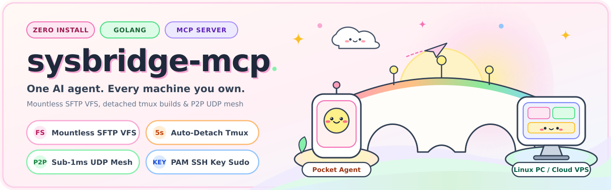
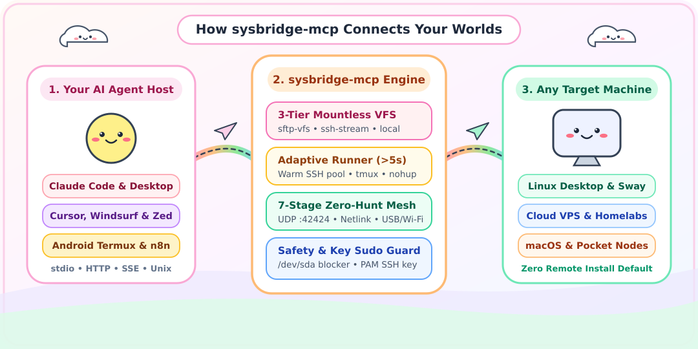

<div align="center">



<br />

[](https://github.com/0xOpCode/sysbridge-mcp/actions/workflows/ci.yml)
[](https://github.com/0xOpCode/sysbridge-mcp/releases)
[](https://pkg.go.dev/github.com/0xOpCode/sysbridge-mcp)
[](https://goreportcard.com/report/github.com/0xOpCode/sysbridge-mcp)
[](LICENSE)
[](https://modelcontextprotocol.io)

**Give your AI agent native filesystem, shell, and desktop control over any remote Linux PC, Cloud VPS, or Android Termux node without installing the agent on the target machine.**

[Why I Built This](#-the-story-why-i-built-sysbridge-mcp) • [Architecture](#-system-architecture) • [Quick Start](#-quick-start) • [MCP Transports](#-multi-protocol-mcp-transports) • [Tool Catalog](#-mcp-tool-catalog) • [Cryptographic Sudo](#-cryptographic-sudo-bridge-pam_ssh_agent_auth) • [Go SDK](#-using-as-a-go-library)

</div>

---

## 📖 The Story: Why I Built `sysbridge-mcp`

I run my AI coding agent from an Android phone inside a Termux + Debian PRoot container while my actual workstation is an HP Pavilion G4 running a stripped-down Arch Linux + Sway Wayland setup (`Daemon OS`). My laptop has an old dual-core AMD A4-3330MX APU that lacks `SSE4.2` and `AES-NI` instructions. Running modern bloated AI IDEs or heavy Node/Electron agent runtimes on that CPU causes immediate `SIGILL` core dumps or eats the RAM alive.

So the brain lived on my phone, and the muscle lived on my laptop.

At first, I did what every engineer does at 2 AM: I wrote a pile of bash scripts (`ssh-laptop`, `ssh-phone`) and a small UDP discovery daemon (`buddy-link`). Then I watched my AI agent try to edit files on the laptop over raw `ssh user@host "cat << 'EOF' > file.go"`.

It was a comedy of errors:
1. **The Backtick Massacre:** Any file containing nested backticks, `$variables`, or escaped quotes got mangled by two layers of shell expansion before hitting disk.
2. **The Wi-Fi Roam Curse:** Whenever I unplugged USB tethering and switched to mobile hotspot, the laptop's IP changed, the TCP pipe snapped, and my 20-minute kernel build died at 94%.
3. **The Termux FUSE Wall:** You cannot run `sshfs` inside an unprivileged Android PRoot container because `/dev/fuse` is locked down.
4. **The Sudo Dilemma:** I wanted my agent to manage systemd services and mount LUKS vaults on my laptop, but I refused to put plaintext sudo passwords in a prompt or set `%wheel ALL=(ALL) NOPASSWD: ALL` so anyone touching my physical keyboard had root.

I realized I did not want an "SSH wrapper." I wanted my agent to treat a remote laptop, a $4/month cloud VPS, or a homelab server **as if its filesystem and process table were local**, with zero software required on the remote machine by default, and optional superpowers when both machines run the binary.

That is why I merged `buddy-link` and my Arch workstation tooling into **`sysbridge-mcp`**.

---

## ⚡ What Makes `sysbridge-mcp` Different

- **Zero-Install Remote Default (Mode A):** Point it at any fresh Ubuntu, Debian, Arch, macOS, or Alpine VPS running standard `sshd`. Nothing needs to be installed on the remote host. No root required on either side.
- **Mountless 3-Tier Virtual Filesystem (`pkg/vfs`):** Works on Android Termux, Docker containers, macOS, and Linux without kernel FUSE (`sshfs`). Surgical file reads, atomic writes, multi-hunk edits, and directory trees run over an in-memory Go SFTP subsystem (`sftp-vfs`) multiplexed over a warm SSH pool, with automatic fallback to POSIX byte streams (`ssh-stream`) if SFTP is disabled.
- **Broken-Pipe Immunity:** Commands that run longer than `5s` (configurable) automatically detach into a remote `tmux` session (or `nohup` + PID sentinel if `tmux` is not installed on the target VPS). Your Wi-Fi can drop for ten minutes while the remote compilation finishes undisturbed.
- **7-Stage Zero-Hunt IP Resolver:** Never type `ip addr` or `arp -a` again. Resolves dynamic peers across UDP `:42424` HMAC-SHA256 beacons, Linux `AF_NETLINK` instant link-state bursts, USB tethering (`rndis0`/`usb0`/`ncm0`), hotspot ARP/ADB neighbor MAC tables, and local subnet probes in `<1ms`.
- **Cryptographic Passwordless Sudo (`pam_ssh_agent_auth`):** Keep `sudo` disabled by default, or enable `sudo.mode: "agent_forward"` to forward your SSH agent socket per request. The remote PAM stack verifies a cryptographic signature from your SSH key, granting the agent root access without ever exposing a password or weakening physical console sudo.
- **Hardware Blocklist Guardrails:** Hard-block specific block devices (such as `/dev/sda` on dual-boot machines) and critical paths (`/boot/efi`) inside the Go engine before any command or file write leaves the process.

---

## 🏗️ System Architecture

<div align="center">

</div>

### How the 3-Tier VFS & Progressive Peer Engine Works

| Layer | Primary Driver | Automatic Fallback | Root Required? | Target Requirement |
| :--- | :--- | :--- | :--- | :--- |
| **Filesystem (`fs_*`)** | `sftp-vfs` (Multiplexed Go SFTP over SSH pool) | `ssh-stream` (Atomic temp-file POSIX byte streams) | No | Standard `sshd` |
| **Command Runner (`exec_run`)** | Warm SSH channel + `tmux` auto-detach (`>5s`) | `nohup` + PID & exit-code sentinel in `/tmp` | No | Standard `/bin/sh` |
| **Port Tunnels (`tunnel_manage`)** | Native Go `net.Listener` <-> `ssh.Client` channel copy | Auto-rebind supervisor on peer IP change | No | `AllowTcpForwarding yes` |
| **Peer Discovery (`peer_*`)** | Static IP / DNS / `~/.ssh/config` host | 7-Stage Cascade + UDP `:42424` HMAC-SHA256 Mesh | No | Optional `sysbridge-mcp daemon` |
| **Privilege Elevation (`sudo`)** | Disabled by default (`sudo.mode: "disabled"`) | `agent_forward` via `pam_ssh_agent_auth.so` | Opt-In | `pam_ssh_agent_auth` |

---

## 🚀 Quick Start

### 1. One-Line Install (Linux, macOS, Android Termux)

```bash
curl -fsSL https://raw.githubusercontent.com/0xOpCode/sysbridge-mcp/main/install.sh | sh
```

### 2. Install via Go Toolchain

```bash
go install github.com/0xOpCode/sysbridge-mcp/cmd/sysbridge-mcp@latest
```

### 3. Build from Source

```bash
git clone https://github.com/0xOpCode/sysbridge-mcp.git
cd sysbridge-mcp
CGO_ENABLED=0 go build -ldflags="-s -w" -o sysbridge-mcp ./cmd/sysbridge-mcp
```

---

## 🎯 Complete User Setup Guide: 3 Progressive Tiers

You can use `sysbridge-mcp` in three progressive tiers depending on how much control you want over the remote machine.

### Tier 1: Zero-Install SSH Mode (Any Cloud VPS, Linux PC, or macOS Host)
**Best for:** Production VPS servers, cloud VMs, or shared machines where you do not want to install extra software or use `sudo`.
- **Target Machine Requirements:** Standard `sshd` and your SSH public key in `~/.ssh/authorized_keys`. Nothing is installed on the remote machine.
- **Controller Setup (`~/.config/sysbridge/config.yaml`):**
  ```yaml
  default_peer: "my_vps"
  peers:
    my_vps:
      name: "my_vps"
      host: "203.0.113.42"          # IP or domain name
      user: "ubuntu"                # Normal non-root user
      ssh_port: 22
      auth:
        method: "key"
        identity_file: "~/.ssh/id_ed25519"
      sudo:
        mode: "disabled"            # Strictly non-sudo
      vfs:
        backend: "auto"             # Uses sftp-vfs, falls back to ssh-stream
        workspace_root: "/home/ubuntu/projects"
  ```
- **Or register dynamically from chat without touching config:**
  Ask your agent: *"Connect to peer `my_vps` at `203.0.113.42` with user `ubuntu` and save config."* (`peer_connect` tool).
- **What you get immediately:** Full `fs_read`, `fs_write`, `fs_edit`, `fs_multi_edit`, `fs_search`, `fs_ops`, `exec_run` (with automatic `nohup` backgrounding for commands `>5s`), and native Go SSH port tunnels (`tunnel_manage`).

---

### Tier 2: Unbreakable Roaming Workstation (`tmux` + `mosh` + `rg` + `rsync`)
**Best for:** Heavy compilation, kernel/Docker builds, and coding over mobile hotspots or unstable Wi-Fi.
1. Ask your agent to audit the remote machine:
   ```text
   Run peer_provision with action="audit" on peer "laptop"
   ```
2. Install the standard packages on the target machine if missing:
   - **Arch Linux:** `sudo pacman -S tmux mosh ripgrep rsync`
   - **Ubuntu / Debian:** `sudo apt install tmux mosh ripgrep rsync`
   - **macOS:** `brew install tmux mosh ripgrep rsync`
- **What this unlocks:**
  - Commands running longer than `5s` detach into named `tmux` sessions (`/tmp/sysbridge_<id>.log`) that you can inspect, tail, or send keystrokes to via `task_control`.
  - `mosh_control` spawns `mosh-server` over UDP `60000:61000` so interactive terminal sessions survive IP changes and laptop sleep.
  - `fs_search` accelerates content search using `rg` (ripgrep), and `sync_transfer` uses delta `rsync`.

---

### Tier 3: Full P2P Mesh (`<1ms` Zero-IP-Hunt) + Cryptographic Agent Sudo
**Best for:** Phone (Termux) <-> Laptop / Homelab setups where IPs change constantly across Wi-Fi, Hotspot, and USB Tethering.

#### Step A: Enable Bidirectional UDP `:42424` Mesh Discovery (Rootless)
1. Generate a shared 256-bit HMAC key on Machine A:
   ```bash
   mkdir -p ~/.config/sysbridge && chmod 700 ~/.config/sysbridge
   sysbridge-mcp keygen > ~/.config/sysbridge/secret.key
   chmod 600 ~/.config/sysbridge/secret.key
   ```
2. Copy the same `~/.config/sysbridge/secret.key` to Machine B and install `sysbridge-mcp` on Machine B (`curl -fsSL https://raw.githubusercontent.com/0xOpCode/sysbridge-mcp/main/install.sh | sh`).
3. Ask the agent to enable the rootless user-level mesh service on Machine B:
   ```text
   Run peer_provision with action="setup_user_mesh" and apply=true on peer "laptop"
   ```
   *(This creates and starts `~/.config/systemd/user/sysbridge-mesh.service` running `sysbridge-mcp daemon --port 42424` without root).*
4. Set `host: "auto"` in your peer config. Both machines now discover each other's live IP in `<1ms` via signed UDP beacons and Linux Netlink interface bursts.

#### Step B: Optional Cryptographic Passwordless Sudo (`pam_ssh_agent_auth`)
If you want your agent to run `sudo` commands on the remote workstation when connected with your SSH key, without setting `NOPASSWD: ALL` for local console users:
1. Ask the agent to generate or apply the PAM configuration:
   ```text
   Run peer_provision with action="setup_pam_ssh_sudo" on peer "laptop"
   ```
2. Ensure `/etc` and `/etc/security` are owned by `root:root` with mode `0755` (`pam_ssh_agent_auth.so` rejects authentication if `/etc` is group-writable `0775`), your public key is in `/etc/security/authorized_keys`, and `sudo.mode: "agent_forward"` is set in `config.yaml`.

---

## 🔌 Multi-Protocol MCP Transports

`sysbridge-mcp` implements every MCP transport protocol in a single static binary:

```bash
# 1. Standard I/O (Default - Claude Code, Claude Desktop, Cursor, Windsurf, Zed)
sysbridge-mcp --transport stdio

# 2. Streamable HTTP (Single /mcp endpoint with session management)
sysbridge-mcp --transport http --listen 127.0.0.1:8787

# 3. Legacy SSE (/sse stream + /message POST for n8n and older MCP gateways)
sysbridge-mcp --transport sse --listen 127.0.0.1:8787

# 4. Dual HTTP Mode (Serves both /mcp Streamable HTTP, /sse + /message, and /healthz on one port)
sysbridge-mcp --transport dual --listen 0.0.0.0:8787

# 5. Unix Domain Socket (Share one warm SSH/SFTP pool across multiple local CLI sessions)
sysbridge-mcp --transport unix --socket ~/.cache/sysbridge/sysbridge.sock
```

### Client Configuration Snippets

<details open>
<summary><b>Claude Code CLI</b></summary>

```bash
claude mcp add sysbridge -- sysbridge-mcp --transport stdio
```
</details>

<details>
<summary><b>Claude Desktop / Cursor / Windsurf (<code>mcp.json</code>)</b></summary>

```json
{
  "mcpServers": {
    "sysbridge": {
      "command": "sysbridge-mcp",
      "args": ["--transport", "stdio", "--config", "~/.config/sysbridge/config.yaml"]
    }
  }
}
```
</details>

<details>
<summary><b>n8n / Remote HTTP Clients</b></summary>

Start the server in `dual` mode with a Bearer token:
```bash
export SYSBRIDGE_TOKEN="your-secret-token"
sysbridge-mcp --transport dual --listen 0.0.0.0:8787
```
Connect n8n's MCP Client node to `http://your-host:8787/sse` or Streamable HTTP clients to `http://your-host:8787/mcp` with header `Authorization: Bearer your-secret-token`.
</details>

---

## 🛠️ MCP Tool Catalog (14 Unified Tools)

Instead of exposing 50 granular shell wrappers that bloat the model's context window, `sysbridge-mcp` provides 14 high-density tools that work identically across local mounts, SFTP, and raw SSH streams:

| Tool Name | Category | Description |
| :--- | :--- | :--- |
| **`peer_list`** | Mesh & Peers | List configured and discovered peers, IP resolution stage, active VFS backend (`sftp-vfs` / `ssh-stream`), and RTT latency. |
| **`peer_connect`** | Mesh & Peers | Probe connectivity, switch the active default peer, or register a new SSH/VPS host at runtime without restarting. |
| **`peer_provision`** | Mesh & Peers | Audit remote capabilities or opt-in provision rootless `systemd --user` mesh beacons and `pam_ssh_agent_auth` sudo rules. |
| **`fs_read`** | Virtual FS | Read remote files with line numbers, `offset`/`limit` pagination, or base64 encoding for binary/image assets. |
| **`fs_write`** | Virtual FS | Atomic remote file write via temp-file + fsync + POSIX rename while preserving file mode bits. |
| **`fs_edit`** | Virtual FS | Surgical exact-block replacement (`old_string` -> `new_string`, single or `replace_all`) returning a unified diff. |
| **`fs_multi_edit`** | Virtual FS | Apply multiple sequential surgical edits to a remote file in one atomic SFTP/stream transaction. |
| **`fs_search`** | Virtual FS | Fast remote file pattern matching (`glob`) and content regex search (`grep` via `rg`/`grep` or SFTP walk). |
| **`fs_ops`** | Virtual FS | Unified filesystem operations: `ls`, `tree`, `stat`, `mkdir`, `mv`, `cp`, `chmod`, `rm` (with confirmation guard), and `sha256`. |
| **`exec_run`** | Compute & Shell | Run commands over warm SSH channels with custom `cwd`, `env`, `sudo`, and automatic `>5s` detachment into `tmux` or `nohup`. |
| **`task_control`** | Compute & Shell | Inspect or control detached background jobs: `list`, `status`, `tail`, `send_keys`, and `kill`. |
| **`mosh_control`** | Roaming UDP | Spawn `mosh-server` on the remote host, verify UDP port reachability (`60000:61000`), and return `MOSH_KEY` session details. |
| **`tunnel_manage`** | Networking | Create, list, and remove persistent or RAM-only local (`-L`) and reverse (`-R`) port tunnels in pure Go. |
| **`sync_transfer`** | File Sync | SFTP push/pull transfers, one-shot `rsync` delta directory sync, and live background directory watchers. |
| **`sys_bridge`** | OS & Desktop | Single-call hardware/OS telemetry, `systemctl` service control, Wayland (`swaymsg`/`grim`) & Android (`adb`) screen capture, clipboard sync, and alerts. |

---

## 🔐 Cryptographic Sudo Bridge (`pam_ssh_agent_auth`)

By default, every peer starts with `sudo.mode: "disabled"`. The agent runs strictly inside the non-root SSH user's permissions.

If you want your agent to perform system administration on your workstation or VPS **without** putting a sudo password in config files and **without** setting `NOPASSWD: ALL` in `/etc/sudoers`:

1. Enable `pam_ssh_agent_auth` on the remote Linux host (you can ask the agent to run `peer_provision` with `action: "setup_pam_ssh_sudo"` to generate or apply the exact config):
   ```text
   # /etc/sudoers.d/sysbridge-agent
   Defaults env_keep += "SSH_AUTH_SOCK"

   # /etc/pam.d/sudo (top line)
   auth sufficient pam_ssh_agent_auth.so file=/etc/security/authorized_keys
   ```
2. Set `sudo.mode: "agent_forward"` for that peer in `~/.config/sysbridge/config.yaml`.
3. When a tool call passes `sudo: true`, `sysbridge-mcp` attaches your local `SSH_AUTH_SOCK` agent channel to that SSH session. `sudo` verifies a cryptographic signature from your SSH private key. Anyone typing `sudo` on the physical laptop keyboard still has to type the normal password.

---

## 📦 Using as a Go Library

All core engines live in importable `pkg/*` packages so you can embed `sysbridge-mcp` into your own Go agents or orchestrators:

```go
package main

import (
	"context"
	"fmt"

	"github.com/0xOpCode/sysbridge-mcp/internal/config"
	"github.com/0xOpCode/sysbridge-mcp/pkg/safety"
	"github.com/0xOpCode/sysbridge-mcp/pkg/transport"
	"github.com/0xOpCode/sysbridge-mcp/pkg/vfs"
)

func main() {
	cfg := config.DefaultConfig()
	guard := safety.NewGuard(cfg.Safety.BlockedDevices, cfg.Safety.BlockedPaths, true)
	pool := transport.NewPool(cfg, guard, nil)
	defer pool.Close()

	fsEngine := vfs.NewEngine(pool)
	res, err := fsEngine.ReadFile(context.Background(), "laptop", "/etc/hostname", 1, 10)
	if err != nil {
		panic(err)
	}
	fmt.Printf("Read via %s: %s\n", res.Backend, res.Content)
}
```

---

## 🧭 Standalone CLI Subcommands

Alongside running as an MCP server, `sysbridge-mcp` includes direct CLI subcommands that replace legacy `buddy-link` and `ssh-laptop` scripts:

```bash
sysbridge-mcp serve [--transport stdio|http|sse|dual|unix] [--listen :8787]
sysbridge-mcp daemon [--port 42424]          # Run background UDP P2P mesh discovery & tunnel supervisor
sysbridge-mcp status [peer]                  # Show peer link status, IP, VFS tier, and telemetry
sysbridge-mcp ip [peer]                      # Output raw resolved peer IP for shell scripts
sysbridge-mcp exec [-d] [-peer name] <cmd>   # Run command on peer (auto-detaches in tmux/nohup with -d)
sysbridge-mcp send [-peer name] <file>       # Push file via SFTP/SCP to peer Downloads directory
sysbridge-mcp tunnel <add|list|remove>       # Manage persistent and RAM-only SSH port tunnels
sysbridge-mcp keygen                         # Generate a new 256-bit hex HMAC mesh secret key
sysbridge-mcp version                        # Print version and build metadata
```

---

## 📄 License

Released under the [MIT License](LICENSE). Built by [Akash Deep (@0xOpCode)](https://github.com/0xOpCode).
